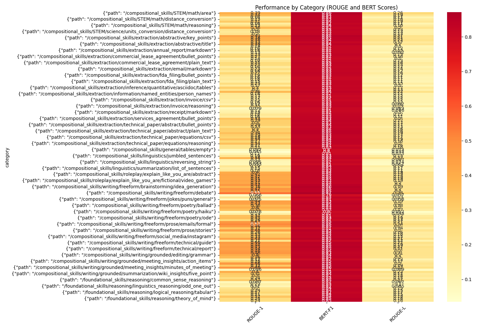
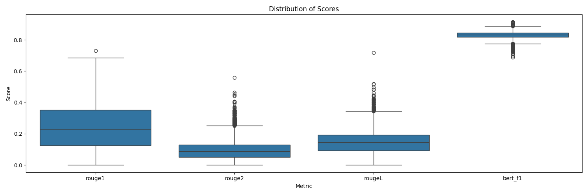
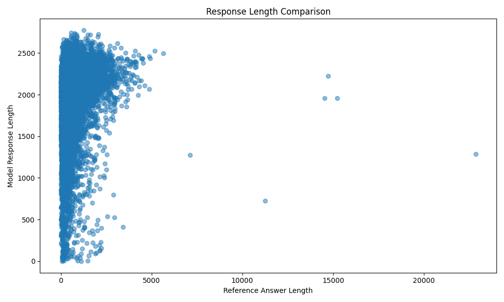
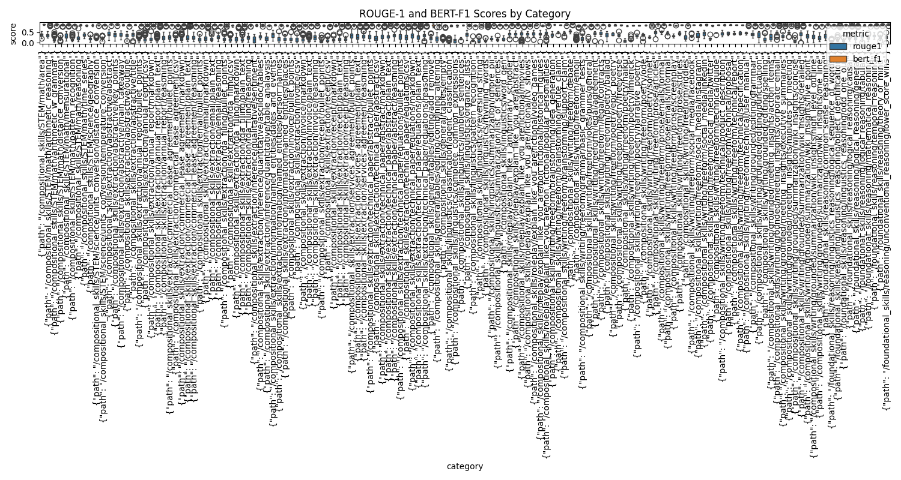

# Comparative Study of InstructLab Models: Granite-7B-Lab vs Merlinite-7B-Lab

## Introduction

Language models have became increasingly important in various applications. In this study, we analyse two InstructLab models: Granite-7B-Lab and Merlinite-7B-Lab. We want to understand there strengths, limitations, and best use cases.

We use a dataset with 13,863 question-answer pairs covering 140 categories. This help us test these models across different types of tasks, from maths to creative writing.

## Models Overview

### Granite-7B-Lab
- Have 7 billion parameters
- Optimized for following instructions
- Context window is 2048 tokens
- Average response length: 1,884 characters

### Merlinite-7B-Lab
- Also have 7 billion parameters
- Better at technical tasks
- Same context window (2048 tokens)
- Average response length: 1,759 characters

## Dataset Information

We used the InstructLab Community Dataset which contains:
- Total of 13,863 question-answer pairs
- Split into 140 categories including:
  - Technical tasks (maths, science, coding)
  - Creative writing tasks
  - Reasoning problems
  - Data extraction tasks
  - And more types

## Evaluation Method and Metrics

### Process Steps
1. Load and prepare dataset
2. Generate response from both models
3. Compare with reference answers
4. Analyze performance by category

### Why We Choose These Metrics

1. **BERT Score**
   - Understands meaning beyond exact words
   - Can identify correct answers even when worded different
   - Matches how humans would judge answers
   - Good for questions with multiple correct ways to answer

2. **ROUGE Scores**
   - Measure exact word matches
   - Important for technical accuracy
   - Works with BERT Score to give full picture
   - Standard metric in the field

## Results Analysis

Before looking at numbers, lets understand what these scores mean. BERT Score above 0.8 shows very good performance, while ROUGE scores compare exact matches between answers.

### Overall Performance Metrics
```
+-------------------------+---------------+---------------+
| Metric                  | Granite       | Merlinite     |
+-------------------------+---------------+---------------+
| BERT Score (F1)        | 0.8299        | 0.8271        |
| ROUGE-1                | 0.2453        | 0.2432        |
| ROUGE-L                | 0.2324        | 0.2298        |
| Average Length         | 1,884 chars   | 1,759 chars   |
| Categories Led         | 103           | 36            |
+-------------------------+---------------+---------------+
```

### Visual Analysis

Each visualization help us understand different aspects of model performance:

#### 1. Category Performance Heatmap

This heatmap shows how good each model is in different categories. Darker colors mean better performance. We can see some categories have consistantly good results while others need improvement.

#### 2. Score Distribution

This graph shows how scores are spread out. The boxes tell us the typical performance range of each model, helping us understand there consistency.

#### 3. Response Length Analysis

Shows how long answers are compared to reference answers. We can see that both models tend to write longer responses then the reference answers.

#### 4. Category Performance Comparison

This breaks down performance by category, showing were each model does better. The patterns help us understand each models strengths.

## Key Findings

### Best Performing Areas

1. **Debate Writing**
   - Highest scores for both models
   - Granite reaches 0.8708 BERT Score
   - Merlinite achieves 0.8675 BERT Score
   - Both show excellent ability in structured arguments

2. **Technical Documentation**
   - Merlinite shows special strength here
   - Provides clear, structured answers
   - Maintains good consistency

3. **Mathematical Problems**
   - Granite performs particularly well
   - Gives accurate calculations
   - Explains steps clearly

### Areas Needing Improvement

1. **Emoji Understanding**
   - Both models score below 0.80 BERT Score
   - Struggle with modern communication styles
   - Need better understanding of informal language

2. **Poetry Generation**
   - Difficult for both models
   - Especially struggle with specific formats like haiku
   - Shows limits in creative tasks

3. **Complex Classification**
   - Both models have lower performance
   - Shows difficulty with nuanced categorization
   - Room for improvement in classification tasks

### Practical Applications

Based on our findings, here's when to use each model:

Choose Granite for:
- Creative writing tasks
- Mathematical problems
- Open-ended questions
- Detailed explanations

Use Merlinite for:
- Technical documentation
- Legal writing tasks
- Structured responses
- Precise answers

## Conclusions

Our evaluation shows different strengths of each model:

**Granite-7B-Lab** performs slightly better overall. It is especially good at creative tasks and giving detailed answers. The model does well across many different types of questions.

**Merlinite-7B-Lab** excels in technical areas. It gives more focused answers and is particularly strong in documentation tasks.

When choosing between these models, consider your specific needs. Use Granite for creative and open-ended tasks, while Merlinite might be better for technical and structured work.

